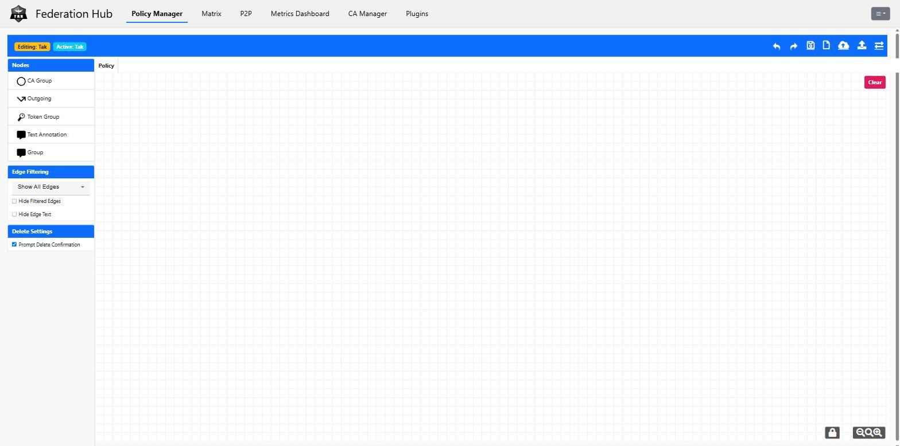
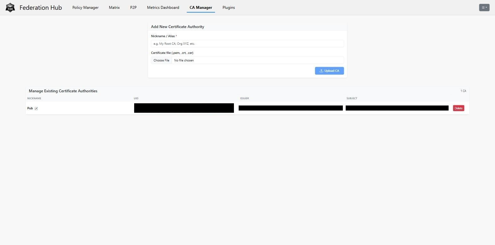
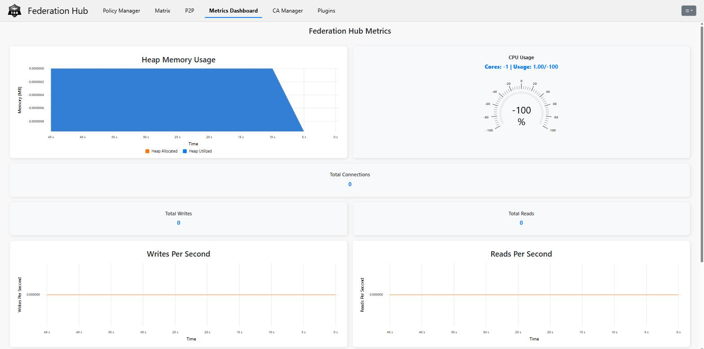

# Federation Hub Setup

Scripts to stand up [TAK Server Federation Hub](https://tak.gov) end-to-end on
a fresh box: MongoDB, the Federation Hub package itself, a dedicated CA with
server/admin certs, and a running systemd service -- ready to manage from its
native admin console.

Federation Hub is TAK Server's dedicated service for linking separate TAK
deployments together, so units on one server can share position, chat, and
other CoT data with units on another. It runs as its own set of Java
processes (a policy manager, plugin manager, UI, and broker) coordinated over
an embedded Apache Ignite cluster, backed by MongoDB for storage, and
presents its own admin console distinct from the main TAK Server web UI.

<table>
<tr>
<td></td>
<td></td>
</tr>
<tr>
<td align="center"><sub>Policy Manager -- drag-and-drop federation rules</sub></td>
<td align="center"><sub>CA Manager -- trusted certificate authorities</sub></td>
</tr>
</table>

<p align="center">
  
  <br>
  <sub>Live broker metrics</sub>
</p>

## Prerequisites

- A Debian/Ubuntu box with `sudo` access and a real terminal (not run through
  an automation tool that lacks a TTY -- see the note below).
- The Federation Hub `.deb` package downloaded separately (TAK.gov account
  required) and placed somewhere `01-base-install.sh` can find it.
- A DNS name for the host already resolving correctly, since the generated
  server certificate is issued for that specific hostname.
- Ports `9100`-`9102` reachable from wherever you'll administer the hub from
  and wherever partner federations will connect from.

## Install

Run these **in order**, in a real terminal -- `sudo` needs an actual TTY,
which won't be available if you're piping this through an automation tool:

```bash
cd federation-hub-setup
bash 01-base-install.sh      # MongoDB 7.0 + openjdk-17-jdk + the .deb
bash 02-mongo-auth.sh        # locks down MongoDB with a generated password
bash 03-generate-certs.sh    # dedicated Federation Hub CA + server + admin certs
bash 04-finish-and-start.sh  # wires certs into config, registers systemd, starts it
```

| Script | What it does |
| --- | --- |
| `01-base-install.sh` | Installs MongoDB 7.0 and `openjdk-17-jdk`, then installs the Federation Hub `.deb`. |
| `02-mongo-auth.sh` | Generates a random password, creates a Mongo user for Federation Hub, and switches MongoDB from no-auth to auth-required. |
| `03-generate-certs.sh` | Builds a **dedicated** Federation Hub CA (kept separate from any TAK Server / EUD CA already on the box), then issues a server cert for the hub's hostname and an admin client cert (`fedhub-admin.p12`) for logging into the console. |
| `04-finish-and-start.sh` | Wires the generated keystore/truststore paths and passwords into Federation Hub's config files, registers the systemd service, and starts it. |

Each script prints what it did and what's next. If a step fails partway
through, don't just re-run it blind -- some of these (cert generation, the
Mongo user) aren't cleanly re-runnable from scratch. Fix the underlying issue
first.

## After install

- Native admin console: `https://<your-host>:9100` (requires the generated
  `fedhub-admin.p12` client certificate for mTLS login -- see step 3's output
  for where that and its password land).
- Federation broker ports: `9101` (v1) and `9102` (v2).
- Generated secrets (Mongo password, keystore/truststore passwords) live in
  `/opt/tak/federation-hub/certs/.fedhub-cert-passwords` and inside the
  written config files -- back these up somewhere safe, they aren't
  reproducible without regenerating certs from scratch.

See [`C4-Raven/c4raven-ui`](https://github.com/C4-Raven/c4raven-ui)'s
[Federation Hub tab](https://github.com/C4-Raven/c4raven-ui/tree/master/docs/federation-hub)
for a Raven-styled admin UI that talks to the same instance without needing
that client certificate for everyday use.

## Known issues in this Federation Hub release

Found while building the above:

- The UI service's embedded web server doesn't fully release its default
  Spring Boot connector before adding its own TLS one, so if anything else on
  the box already holds port 8080 (common -- e.g. an existing TAK Server
  install's insecure HTTP listener), the whole UI service fails to start.
  Worked around here by pointing `server.port`/`server.address` at an
  internal, loopback-only port via JVM system properties in
  `federation-hub-ui.sh`, rather than changing anything else on the box.
- The bundled Keycloak/OAuth login option is broken: the login flow completes
  and Keycloak issues a token with the correct claims, but Federation Hub's
  own session validation still rejects it afterward. mTLS with the generated
  admin client cert is the only working login path in this release.
